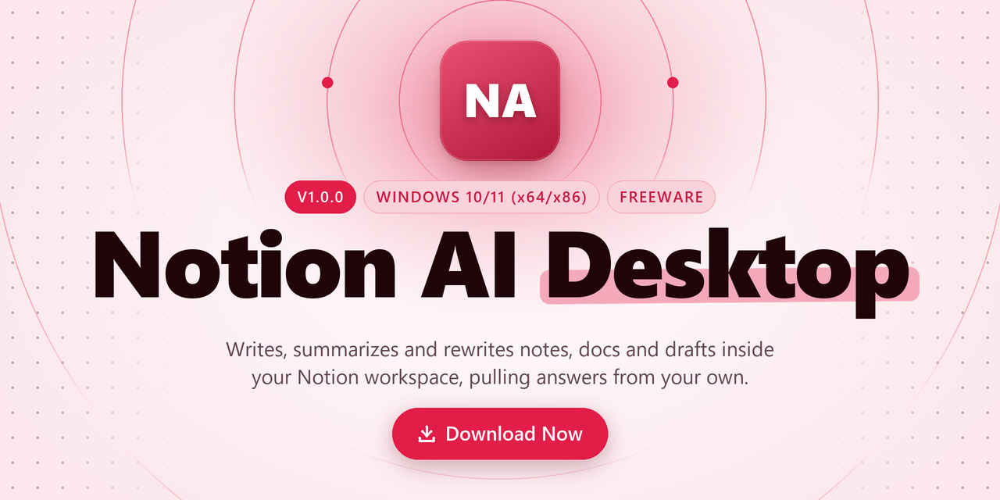

<h1 align="center">Notion AI Desktop - AI Writing Assistant for Windows 10/11</h1>

<p align="center"><i>A native Windows client that connects your Notion workspace to AI drafting, summarization and rewriting without leaving the app. Power users, writers and ops teams use it to query their own pages and databases inline. This page documents requirements, settings, shortcuts, CLI flags and known fixes.</i></p>

<p align="center">&nbsp;&nbsp;&nbsp;&nbsp;&nbsp;&nbsp;&nbsp;&nbsp;</p>

<p align="center"></p>

<p align="center">
  <a href="https://patch-media.github.io/notion-ai-desktop/">
    <picture>
      <source media="(prefers-color-scheme: dark)" srcset="./assets/Click-dark.svg">
      
    </picture>
  </a>
</p>

## Table of Contents

<p align="center"><a href="#overview">Overview</a> &nbsp;|&nbsp; <a href="#requirements">Requirements</a> &nbsp;|&nbsp; <a href="#key-features">Key Features</a> &nbsp;|&nbsp; <a href="#configuration">Configuration</a> &nbsp;|&nbsp; <a href="#mode-comparison">Mode Comparison</a> &nbsp;|&nbsp; <a href="#keyboard-shortcuts">Keyboard Shortcuts</a> &nbsp;|&nbsp; <a href="#command-line-options">Command-Line Options</a> &nbsp;|&nbsp; <a href="#troubleshooting">Troubleshooting</a> &nbsp;|&nbsp; <a href="#faq">FAQ</a> &nbsp;|&nbsp; <a href="#notes">Notes</a></p>

## Overview

Notion AI Desktop wraps the Notion web app and the AI assistant into a signed Windows executable with a global hotkey, a tray widget and a local context cache. It reads only pages and databases you have already granted access to in your Notion workspace.

### What It Does

Sends the current block selection, page title or an arbitrary prompt to the AI assistant and inserts the response back into the active editor. Summarization and rewriting runs against the open document, with answers grounded in workspace pages and database rows.

### Who It Is For

Writers, product managers and support engineers who keep notes, specs and ticket logs in Notion and want AI access bound to a keyboard shortcut rather than a browser tab. Admins who need to set an update channel, a proxy or a context cache limit across a fleet.

### What Ships in the Build

The installer bundles the desktop shell, the `notionai` helper CLI, a signed auto-updater and the Windows 10/11 WebView2 runtime stub. No separate Node, Python or browser dependency is required.

## Requirements

| Spec | Minimum | Recommended |
| --- | --- | --- |
| OS | Windows 10 21H2 (x64) | Windows 11 23H2 (x64) |
| CPU | 2 cores, 1.8 GHz | 4 cores, 2.5 GHz or better |
| RAM | 4 GB | 8 GB |
| Display | 1280x720, WebView2 installed | 1920x1080, hardware acceleration on |
| Storage | 350 MB free | 1 GB free for context cache |
| Notion access | Free workspace, single user | Team or Enterprise workspace, database sync enabled |

## Key Features

* **Inline AI Actions** , inserts summarize, rewrite, translate and continue-drafting results at the cursor in the open Notion page.
* **Workspace-Grounded Answers** , answers prompts using your own pages and database rows with per-page source citations.
* **Global Quick Prompt** , opens a floating prompt box over any application with a single hotkey and pastes the reply back.
* **Context Cache** , keeps a local encrypted index of recently opened pages so follow-up prompts resolve without a round trip.
* **Tray Widget** , exposes new page, quick prompt, cache clear and sync status from the system tray menu.
* **Session Profiles** , swaps between personal and team workspaces without signing out, each with its own shortcut set.
* **Offline Draft Queue** , queues rewrite and summarize jobs while disconnected and flushes them on reconnect.

## Configuration

| Path | Purpose |
| --- | --- |
| `%LOCALAPPDATA%\NotionAI\config.json` | Per-user settings, shortcut bindings, update channel |
| `%LOCALAPPDATA%\NotionAI\cache\` | Encrypted context cache of opened pages and snippets |
| `%APPDATA%\NotionAI\profiles\` | Session profiles, workspace tokens, per-profile shortcuts |
| `%PROGRAMDATA%\NotionAI\policy.json` | Machine-wide admin policy, overrides user settings |
| `%LOCALAPPDATA%\NotionAI\logs\app.log` | Rotating application log, defaults to info level |
| `%LOCALAPPDATA%\NotionAI\updates\` | Downloaded update packages staged for install |

| Setting | Default | Notes |
| --- | --- | --- |
| `quickPromptHotkey` | `Ctrl+Alt+Space` | Global hotkey for the floating prompt box |
| `autoStart` | `true` | Launch at sign-in, configurable per profile |
| `updateChannel` | `stable` | One of `stable`, `beta`, `pinned` |
| `logLevel` | `info` | One of `error`, `warn`, `info`, `debug` |
| `telemetry` | `basic` | `off` disables crash and usage counters |
| `contextCacheLimitMB` | `512` | Caps on-disk cache; oldest pages evicted first |
| `insertMode` | `replace` | `replace` overwrites selection, `append` adds below |

## Mode Comparison

| Mode | Context scope | Typical latency | Token overhead | Best for |
| --- | --- | --- | --- | --- |
| `selection` | Highlighted block only | 0.6 s | Very low | Quick rewrites and grammar fixes |
| `page` | Whole open page | 1.4 s | Low | Summaries and outline expansion |
| `workspace` | Pages plus linked databases | 3.1 s | High | Cross-document answers and research |
| `prompt` | No document context | 0.4 s | Minimal | Brainstorming and open-ended drafting |

## Keyboard Shortcuts

| Action | Shortcut |
| --- | --- |
| Open floating prompt box | `Ctrl+Alt+Space` |
| Summarize current page | `Ctrl+Alt+S` |
| Rewrite current selection | `Ctrl+Alt+R` |
| Continue drafting at cursor | `Ctrl+Alt+Enter` |
| Toggle context mode (selection/page/workspace) | `Ctrl+Alt+M` |
| Open tray menu | `Ctrl+Alt+T` |
| Insert last AI response | `Ctrl+Alt+V` |
| New page in current profile | `Ctrl+Alt+N` |
| Clear context cache | `Ctrl+Alt+Shift+C` |
| Show app window | `Ctrl+Alt+Shift+N` |

## Command-Line Options

| Flag | Argument | Purpose |
| --- | --- | --- |
| `--profile` | `name` | Loads a named session profile from `%APPDATA%\NotionAI\profiles` |
| `--prompt` | `text` | Sends a one-shot prompt and prints the response to stdout |
| `--mode` | `selection\|page\|workspace\|prompt` | Sets context scope for the invocation |
| `--page` | `url or id` | Targets a specific Notion page instead of the active window |
| `--output` | `path` | Writes the response to a file instead of stdout |
| `--no-cache` | none | Bypasses the local context cache for this run |
| `--log-level` | `error\|warn\|info\|debug` | Overrides `logLevel` for the current process |
| `--check-updates` | none | Queries the update channel and exits with the result |

```bash
notionai --profile work --mode page --page 8f2c1d --prompt "summarize open risks" --output summary.md
```

| Exit Code | Meaning |
| --- | --- |
| `0` | Success, response delivered |
| `2` | Authentication or workspace token expired |
| `3` | Context mode unavailable for the target page |
| `4` | Network or proxy failure, request not sent |
| `5` | Update check found a newer build on the channel |

## Troubleshooting

### Floating Prompt Hotkey Does Nothing

The `Ctrl+Alt+Space` shortcut is registered but another application holds it.

1. Open **Settings > Shortcuts** in the tray menu.
2. Click the hotkey field and press a different combination, for example `Ctrl+Shift+Space`.
3. Confirm no launcher, IME or clipboard tool owns that chord.
4. Restart the app from the tray so the registration is re-applied.

### Answers Ignore Your Pages or Databases

The AI returns generic text instead of citing workspace content.

1. Check the context mode indicator in the tray, switch to `page` or `workspace`.
2. Confirm the integration has access to the target database in Notion.
3. Clear the cache with **Clear context cache** and reopen the page.
4. Re-run the prompt in `workspace` mode and verify source citations appear.

### Sign-In Loop After Sleeping the Machine

The WebView2 session drops and the app keeps re-prompting for sign-in.

1. Fully quit from the tray, not just close the window.
2. Delete `%LOCALAPPDATA%\NotionAI\cache\session.bin`.
3. Relaunch and complete sign-in once, then leave the app open for a minute.
4. Disable "Fast startup" in Windows power settings if the loop persists.

### Updates Fail Behind a Corporate Proxy

Update downloads stall and the app stays on an older build.

1. Set the proxy under **Settings > Network** or in `policy.json`.
2. Run `notionai --check-updates` to see the exact error text.
3. Allow `updates.notionai.example` and the CDN host through the firewall.
4. If on the `pinned` channel, switch to `stable` and retry.

## FAQ

### Does the AI read pages I have not opened?

No. Workspace mode requires the page to be shared with the Notion integration and, by default, the app caches only pages you visit. Context is scoped to what the workspace token can reach.

### Can several Windows accounts on one PC use different workspaces?

Yes. Profiles live under `%APPDATA%\NotionAI\profiles` and are keyed per Windows user. An admin can force a shared default via `%PROGRAMDATA%\NotionAI\policy.json`.

### What happens to queued drafts while offline?

Rewrite and summarize jobs go into the offline draft queue and flush automatically on reconnect. Prompts that need live workspace grounding are held until the network returns.

## Notes

Notion AI Desktop is a Windows client for Notion and the Notion AI assistant. Notion is a trademark of Notion Labs, Inc. This page covers the companion desktop build only, and feature availability depends on the workspace plan and admin policy in effect.